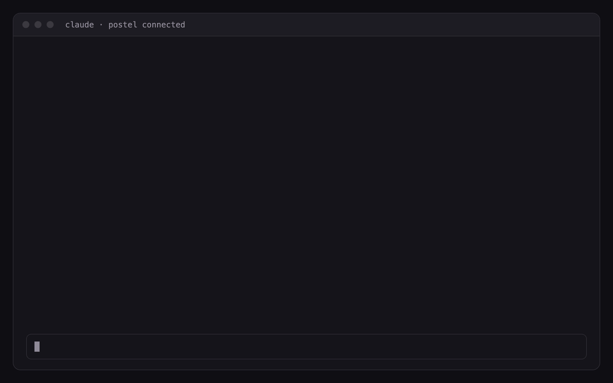
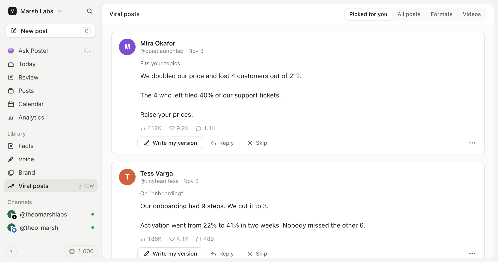

<p align="center">
  <a href="https://www.postel.app/?utm_source=github-postel-mcp&utm_medium=readme&utm_campaign=agent-distribution">
    <picture>
      <source media="(prefers-color-scheme: dark)" srcset="assets/postel-logo-dark.png">
      
    </picture>
  </a>
</p>

<h3 align="center">Find what's going viral in your niche, write your version in your own voice, and schedule it, without leaving Claude, ChatGPT, Cursor or any MCP client.</h3>

<p align="center">
  <a href="https://registry.modelcontextprotocol.io/v0/servers?search=app.postel"></a>
  <a href="https://claude.ai/directory/connectors/www-postel-app"></a>
  
  
  <a href="LICENSE"></a>
</p>

<p align="center">
  <a href="https://claude.ai/directory/connectors/www-postel-app"></a>
  <a href="https://cursor.com/en/install-mcp?name=postel&config=eyJ1cmwiOiJodHRwczovL3d3dy5wb3N0ZWwuYXBwL2FwaS9tY3AifQ=="></a>
  <a href="https://vscode.dev/redirect/mcp/install?name=postel&config=%7B%22type%22%3A%22http%22%2C%22url%22%3A%22https%3A//www.postel.app/api/mcp%22%7D"></a>
</p>

<p align="center">
  
</p>

[Postel](https://www.postel.app/?utm_source=github-postel-mcp&utm_medium=readme&utm_campaign=agent-distribution) is an AI writing and scheduling tool for people who post as themselves: founders, consultants and creators. This repository holds the public side of its hosted MCP server: setup for every client, the Claude Code plugin, the Gemini CLI extension, an agent skill and the MCP Registry entry. The server runs at `https://www.postel.app/api/mcp`; there is nothing to install or host.

- **Start from what's working.** Postel keeps a library of posts that took off for real creators, scored by how far each one beat its author's usual reach. Your assistant searches it by topic and shows you why the top ones worked.
- **Sound like you.** Drafts come from your voice profile (built from your own X or LinkedIn posts) and the facts you saved, not from a generic template.
- **Schedule where you post.** X (posts and threads), personal LinkedIn profiles, Bluesky, Mastodon, YouTube and TikTok, through each network's official API, after you approve.

| | |
|---|---|
| Server URL | `https://www.postel.app/api/mcp` |
| Transport | Streamable HTTP |
| Sign-in | OAuth 2.1 with dynamic client registration, or a `pstl_` API key as a bearer token |
| Works without an account | `search-viral-tweets` |
| Registry name | `app.postel/postel` |

## Install

| Client | Fastest way |
|---|---|
| Claude (web, desktop, mobile) | [Connect from Claude's directory](https://claude.ai/directory/connectors/www-postel-app) |
| Claude Code | `/plugin marketplace add robinfaraj/postel-mcp` then `/plugin install postel@postel` |
| Cursor | [One-click install](https://cursor.com/en/install-mcp?name=postel&config=eyJ1cmwiOiJodHRwczovL3d3dy5wb3N0ZWwuYXBwL2FwaS9tY3AifQ==) |
| VS Code | [One-click install](https://vscode.dev/redirect/mcp/install?name=postel&config=%7B%22type%22%3A%22http%22%2C%22url%22%3A%22https%3A//www.postel.app/api/mcp%22%7D) |
| Gemini CLI | `gemini extensions install https://github.com/robinfaraj/postel-mcp` |
| Codex CLI | `codex mcp add postel --url https://www.postel.app/api/mcp` |
| ChatGPT | Custom connector with developer mode, [see below](#chatgpt) |
| Hermes Agent | `hermes plugins install postel --enable`, [see below](#hermes-agent) |
| DeepSeek Harness | `dsh plugin --profile web add "github:robinfaraj/postel-mcp#path:/plugins/dsh-postel"` |
| Kimi Code CLI | `/plugins install https://github.com/robinfaraj/postel-mcp` |
| Grok Build | `grok plugin marketplace add robinfaraj/postel-mcp` then `grok plugin install postel --trust` |
| Skills (Codex, Cursor, OpenClaw and 70+ agents) | `npx skills add robinfaraj/postel-mcp` |
| Anything else | Point it at `https://www.postel.app/api/mcp` |

Before your first post, connect your networks in Postel under **Settings > Channels**. Research works right away; drafting, scheduling and publishing need a Postel account.

### Claude (web, desktop, mobile)

Open [Postel in Claude's connector directory](https://claude.ai/directory/connectors/www-postel-app), click **Connect** and sign in to Postel. Or add it by hand: **Customize > Connectors**, **+**, **Add custom connector**, enter `https://www.postel.app/api/mcp`.

### Claude Code

```
/plugin marketplace add robinfaraj/postel-mcp
/plugin install postel@postel
```

Then run `/mcp` and sign in to Postel. The plugin adds the server and the `postel-writing` skill, which teaches Claude the research, drafting and scheduling workflow. Without the plugin:

```bash
claude mcp add --transport http postel https://www.postel.app/api/mcp
```

Add `--scope user` to use it in every project, or `--header "Authorization: Bearer pstl_YOUR_API_KEY"` to use an API key instead of signing in.

### Cursor

Click **Add to Cursor** above, or add this to `~/.cursor/mcp.json` (or `.cursor/mcp.json` in a project):

```json
{
  "mcpServers": {
    "postel": {
      "url": "https://www.postel.app/api/mcp"
    }
  }
}
```

Cursor runs the sign-in the first time a tool needs your account. To use an API key, add `"headers": { "Authorization": "Bearer pstl_YOUR_API_KEY" }`.

### VS Code

Click **Install in VS Code** above, or add this to `.vscode/mcp.json`:

```json
{
  "servers": {
    "postel": {
      "type": "http",
      "url": "https://www.postel.app/api/mcp"
    }
  }
}
```

### Gemini CLI

```bash
gemini extensions install https://github.com/robinfaraj/postel-mcp
```

Then run `/mcp auth postel` inside Gemini CLI to sign in. The extension adds the server and a short `GEMINI.md` with the same workflow rules as the skill.

### Codex CLI

```bash
codex mcp add postel --url https://www.postel.app/api/mcp
codex mcp login postel
```

### Hermes Agent

```
hermes plugins install postel --enable
hermes mcp add postel --url https://www.postel.app/api/mcp --auth oauth --connect-timeout 300
```

The plugin ([`agent-plugin/`](agent-plugin/), a portable Agent Plugins v1 package) adds the server and the `postel-writing` skill, and asks Hermes to confirm every tool that isn't read-only. The second command signs you in. Until the plugin is in your Hermes catalog, the second command alone gives you the tools.

The same `agent-plugin/` folder works as a Perplexity Computer custom plugin (Plugins, **Add custom**, paste this repository's URL) and as a NanoClaw template.

### DeepSeek Harness

```bash
dsh plugin --profile web add "github:robinfaraj/postel-mcp#path:/plugins/dsh-postel"
```

Research works without a key. To draft and schedule, set `POSTEL_API_KEY` before starting dsh. Details: [`plugins/dsh-postel`](plugins/dsh-postel/).

### Kimi Code CLI

In Kimi Code, run `/plugins install https://github.com/robinfaraj/postel-mcp`, then `/reload` and `/mcp-config login postel` to sign in. The plugin (`kimi.plugin.json`) adds the server and the `postel-writing` skill.

### Grok Build

```bash
grok plugin marketplace add robinfaraj/postel-mcp
grok plugin install postel --trust
```

### ChatGPT

In ChatGPT, open **Settings > Apps & Connectors > Advanced settings**, turn on **Developer mode**, then **Create** a connector with the URL `https://www.postel.app/api/mcp` and OAuth sign-in. OpenAI decides which plans can use custom connectors that write (draft, schedule, publish); at the time of writing that is Business, Enterprise and Edu workspaces, while research works more widely. Step-by-step: [connect ChatGPT to LinkedIn](https://www.postel.app/connect-chatgpt-to-linkedin?utm_source=github-postel-mcp&utm_medium=readme&utm_campaign=agent-distribution) and [to X](https://www.postel.app/connect-chatgpt-to-x?utm_source=github-postel-mcp&utm_medium=readme&utm_campaign=agent-distribution).

### Windsurf, Zed, Goose and other clients

Any client that supports remote MCP servers over Streamable HTTP works. Point it at `https://www.postel.app/api/mcp` and let it run the OAuth sign-in, or send `Authorization: Bearer pstl_YOUR_API_KEY`. Windsurf names the field `serverUrl` instead of `url`. For a client that only runs local servers, use a bridge such as `npx mcp-remote https://www.postel.app/api/mcp`.

Create an API key in Postel under **Settings > API Keys**. Keys start with `pstl_` and belong to one workspace.

### Agent skills

Two plain [Agent Skills](https://agentskills.io) for any agent that reads `SKILL.md` files:

- `postel-writing` (in `skills/`): how to research, write for each network and confirm before scheduling or publishing, using the MCP server above.
- `postel-api` (in `.agents/skills/`): the same workflow over Postel's REST API with `curl` and a `POSTEL_API_KEY`, for agents without MCP support.

```bash
npx skills add robinfaraj/postel-mcp
```

## Example prompts

- "What's going viral about cold email this month? Write my take for LinkedIn: we stopped using templates and reply rates doubled."
- "Find the most-viewed posts about bootstrapping a SaaS and tell me what the best hooks have in common."
- "Turn this blog post into an X thread and schedule it for Thursday at 3pm New York time."
- "Write the same announcement for X, LinkedIn and Bluesky, each in its own style, and put the changelog link in the LinkedIn first comment."
- "Here's my new video: (link). Write the description, attach the video and save it as a YouTube draft so I can set the title in Postel."
- "Turn these five notes into posts for Monday to Friday at 9am and attach this screenshot to the first one."
- "Show me what's scheduled for next week."

## Tools

17 tools. `search-viral-tweets` works without an account; the rest need a signed-in Postel account or an API key. Every tool carries a title and read-only or destructive hints, so your client can ask before anything is scheduled, published or deleted.

### Research and writing

| Tool | What it does |
|---|---|
| `search-viral-tweets` | Finds high-performing X posts by topic in Postel's library, with links and engagement. No sign-in needed |
| `generate-post` | Writes a post or an X thread in your voice and saves it as a draft (1 AI credit) |
| `refine-post` | Suggests a rewrite of a draft from your instructions, without saving it (1 AI credit) |

### Posts

| Tool | What it does |
|---|---|
| `create-post` | Saves text as a draft for any connected network, with optional images or video from public URLs and a LinkedIn first comment |
| `create-posts` | Saves up to 25 posts in one call, each with its own network, media and first comment, and schedules the ones with a date |
| `attach-media` | Downloads an image or video from a public URL and adds it to a draft |
| `update-post` | Edits a draft |
| `schedule-post` | Schedules a draft for a future time |
| `publish-post` | Publishes a draft now |
| `delete-post` | Deletes a post and cancels its schedule |
| `list-posts` | Lists posts, with an optional status filter |
| `get-post` | Returns one post |

### Your context

| Tool | What it does |
|---|---|
| `get-x-profiles` | Returns your X and LinkedIn voice profiles |
| `list-brands` | Lists your brands and topics |
| `get-brand-sources` | Returns the background sources saved for a brand |
| `get-schedule` | Returns your weekly posting slots and timezone |
| `get-usage` | Shows your AI credit balance |

## Networks

| Network | What you can post |
|---|---|
| X (Twitter) | Posts and threads, up to 4 images or one video or GIF. No X developer account or API credits needed |
| LinkedIn | Personal profiles: up to 3,000 characters, up to 20 images or one video, and a first comment of up to 1,250 characters posted right after the post |
| Bluesky | Posts and threads, 300 characters, up to 4 images. Connect with your handle and an app password |
| Mastodon | Posts and threads on any server, at your server's character limit, with images, a video or a GIF |
| YouTube | One video per post, uploaded to your channel, with the post text as its description. A vertical or square video of 3 minutes or less becomes a Short. Google asks you to choose the title, privacy (public, unlisted or private) and "made for kids" for every video, so your assistant writes the description, attaches the video from a public link and saves a draft; you set those three in Postel's editor, then your assistant or you schedule it |
| TikTok | One video per post, with a caption of up to 2,200 characters. TikTok asks you to choose who can view it, whether to allow comments, duets and stitches, and whether it's commercial content for every post, so it works like YouTube: your assistant saves a draft, you finish those settings in Postel's editor, then it's scheduled. Until TikTok finishes reviewing Postel's posting access, TikTok posts go out as "Only me" and your TikTok account has to be set to private |

Publishing to LinkedIn company Pages, Threads and Instagram is built and submitted for each network's app review, with no date yet. The in-app viral library already covers X posts and short and long videos from YouTube, TikTok and Instagram creators; over MCP, research covers X posts.

## What it doesn't do

- It doesn't read your timeline, feed, mentions, DMs or messages on any network.
- It doesn't like, reply, follow, comment on other people's posts or send connection requests. It is for publishing your own posts, not outreach.
- It never asks for your passwords or cookies, and it doesn't drive a browser. Posts go through each network's official API with the permissions you grant.
- Images and video come from public URLs, up to 100 MB. Local files and LinkedIn PDF carousels go in the Postel editor.
- It doesn't show YouTube analytics, set thumbnails or playlists, or read video transcripts.
- Research searches Postel's indexed library, not live X, and the engagement numbers are snapshots.

## REST API, Zapier, n8n and Make

The same actions are available over a plain REST API at `https://www.postel.app/api/v1` with the same `pstl_` keys: create, schedule and publish posts, write in your voice, search the viral library across X, YouTube, TikTok and Instagram, and poll for events such as a new viral post in your niche. Reference: [postel.app/api/docs](https://www.postel.app/api/docs). Zapier, n8n and Make apps built on it are on the way.

## Plans

- The MCP server is included in every paid Postel plan. Starter and Pro start with a 7-day trial for $1; Starter is $29 a month, or $19 a month billed yearly. See [pricing](https://www.postel.app/?utm_source=github-postel-mcp&utm_medium=readme&utm_campaign=agent-distribution#pricing).
- `generate-post` and `refine-post` use 1 AI credit each. Saving text your assistant wrote uses none.
- If your workspace requires approval, scheduling submits the post for an owner or admin to approve in Postel.
- API keys are limited to 60 requests a minute.

## FAQ

**Can Claude post to LinkedIn or X?** Yes, with this server connected. Claude drafts the post, you approve it, and Postel publishes or schedules it to your account.

**Is there an official LinkedIn MCP server?** Not as of November 2026. LinkedIn hasn't published one, so every LinkedIn MCP server, this one included, is third-party. Postel uses LinkedIn's official posting API rather than your browser session.

**Do I need an X API key or a LinkedIn developer app?** No. You connect your accounts to Postel once, and the server uses those connections.

**How is this different from asking Claude to write a post?** Claude can write without it. Postel adds what Claude doesn't have: a library of posts that are working right now, your saved voice and facts, your posting schedule, and the connection that actually puts the post on each network.

## Links

- [Postel MCP server: setup guide and FAQ](https://www.postel.app/postel-mcp-server?utm_source=github-postel-mcp&utm_medium=readme&utm_campaign=agent-distribution)
- [LinkedIn MCP server](https://www.postel.app/linkedin-mcp-server?utm_source=github-postel-mcp&utm_medium=readme&utm_campaign=agent-distribution) · [X MCP server](https://www.postel.app/x-mcp-server?utm_source=github-postel-mcp&utm_medium=readme&utm_campaign=agent-distribution)
- [Connect Claude to LinkedIn](https://www.postel.app/connect-claude-to-linkedin?utm_source=github-postel-mcp&utm_medium=readme&utm_campaign=agent-distribution) · [to X](https://www.postel.app/connect-claude-to-x?utm_source=github-postel-mcp&utm_medium=readme&utm_campaign=agent-distribution)
- [Social media MCP servers compared](https://www.postel.app/best-social-media-mcp-servers?utm_source=github-postel-mcp&utm_medium=readme&utm_campaign=agent-distribution)
- [Privacy policy](https://www.postel.app/en/legal/privacy-policy?utm_source=github-postel-mcp&utm_medium=readme&utm_campaign=agent-distribution) · [Terms](https://www.postel.app/en/legal/terms?utm_source=github-postel-mcp&utm_medium=readme&utm_campaign=agent-distribution) · [Contact](https://www.postel.app/en/contact?utm_source=github-postel-mcp&utm_medium=readme&utm_campaign=agent-distribution)

<p align="center">
  
</p>

## License

The files in this repository are released under the [MIT License](LICENSE). The Postel service itself is covered by its own [terms](https://www.postel.app/en/legal/terms?utm_source=github-postel-mcp&utm_medium=readme&utm_campaign=agent-distribution). Postel is made by JRS Content Solutions UG.
